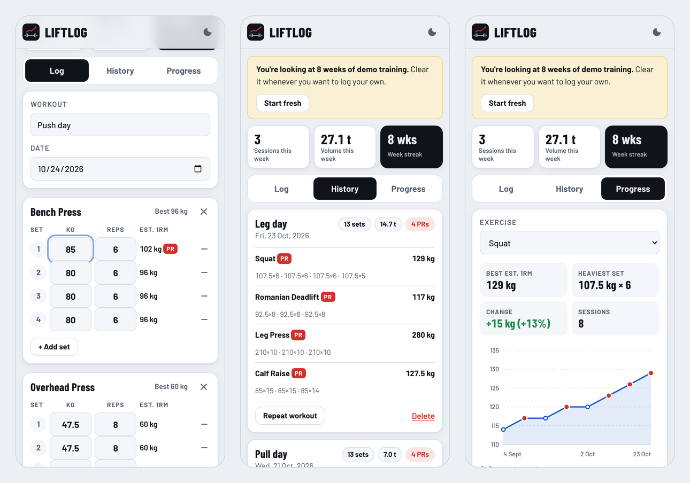
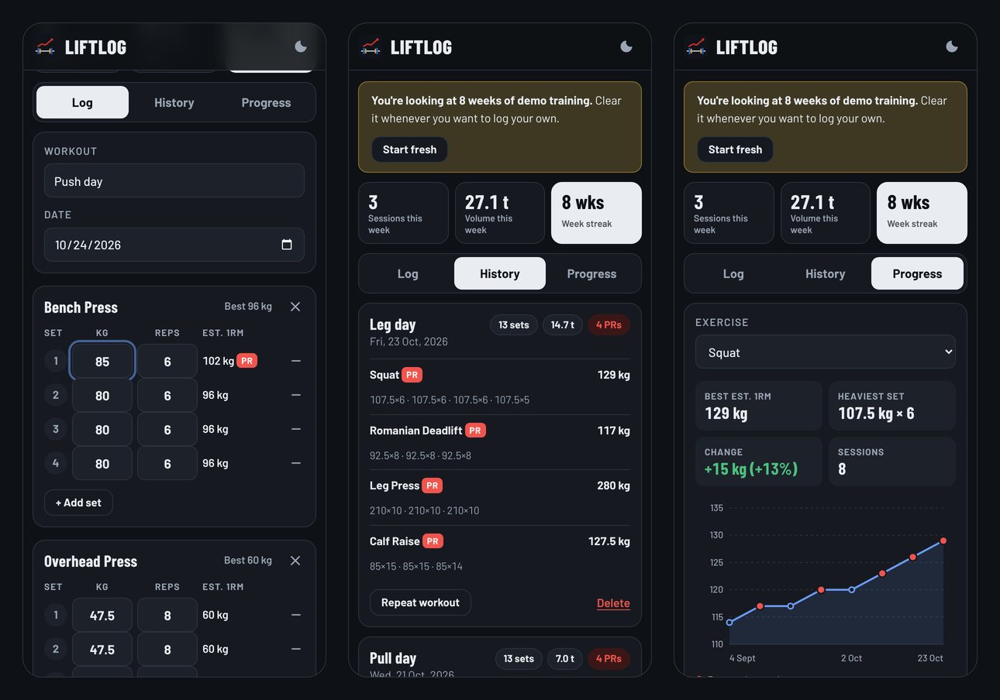

# LiftLog: Workout Tracker

An offline-first workout tracker for lifters. Log sets in seconds, get **personal records detected automatically**, and see whether your strength is actually going up.

**[Live demo →](https://coach-who-codes.github.io/workout-tracker/)** (loads 8 weeks of demo training, and you can install it on your phone)

[](https://github.com/coach-who-codes/workout-tracker/actions/workflows/test.yml)




## Why I built it

As a coach, the first thing I ask a client is: *"What did you lift last week?"* Most people don't know, and without that number progressive overload is guesswork. Notes apps don't show trends, and many tracking apps take too many taps between sets. LiftLog is built for the gym floor:

- It **pre-fills each exercise with what you lifted last time**, so you only change what's different.
- It **flags a PR the moment you type it**, comparing your estimated 1RM with your previous best.
- It **works with no signal** (gym basements are bad for mobile data).

## Features

| | |
|---|---|
| **Log** | Start from a recent workout in one tap, or add exercises (presets + your own). Each set shows its estimated 1RM live, with a **PR** badge when you beat your best. Your draft is saved automatically, so closing the tab loses nothing. |
| **History** | Every session with total sets, volume (kg moved) and PRs. Tap **Repeat workout** to load it as today's template. Delete needs two taps, so you don't lose a session by accident. |
| **Progress** | Pick a lift to see your best estimated 1RM, heaviest set, % change and a line chart over time with PR sessions highlighted. |
| **Weekly stats** | Sessions this week, weekly volume and a **week streak** (consecutive weeks with at least one session). |
| **Your data** | Stored on the device (`localStorage`). Export and import a JSON backup. Light and dark themes. |
| **Installable** | Web app manifest + service worker (stale-while-revalidate cache), so it installs to the home screen and runs offline. |

<details>
<summary>Dark mode</summary>


</details>

## How it works

**Estimated 1RM:** uses the Epley formula, rounded to the nearest 0.5 kg:

```
e1RM = weight × (1 + reps / 30)        // 100 kg × 5 reps ≈ 116.5 kg
```

**PR detection** (`detectPRs` in `src/lifts.js`) walks your history in date order and keeps the best e1RM per exercise. A session is a PR only if it beats *every earlier* session. The first time you log an exercise is a baseline, not a PR. Because it sorts first, the result is the same whatever order workouts were saved in, and a test checks exactly that.

**Week streak** counts consecutive Monday-to-Sunday weeks with a session. The current week only breaks the streak once it's over, so opening the app on a Monday doesn't reset you to zero.

## Project structure

```
workout-tracker/
├── index.html             # app shell: tabs, panels, templates
├── styles.css             # design tokens, light/dark, mobile-first layout
├── manifest.webmanifest   # install metadata
├── sw.js                  # offline cache
├── src/
│   ├── lifts.js           # pure logic: e1RM, volume, PRs, history, streaks
│   ├── store.js           # localStorage, demo programme, import/export
│   ├── chart.js           # dependency-free SVG line chart
│   └── app.js             # UI state, rendering, events
├── tests/lifts.test.js    # 13 unit tests (node:test)
└── icons/
```

No framework and no build step, on purpose: the whole app is about 50 KB of code and loads fast even on a cheap phone. The logic in `lifts.js` has no DOM code, so it's tested directly in Node.

## Run it locally

```bash
git clone https://github.com/coach-who-codes/workout-tracker.git
cd workout-tracker
npx serve .     # service workers need http://localhost, not file://
npm test
```

## Next steps

- [ ] Rest timer between sets with a vibration alert
- [ ] Plate calculator (which plates to load for a target weight)
- [ ] Optional cloud sync so a coach can see a client's log

## License

MIT © Amit Dubey
